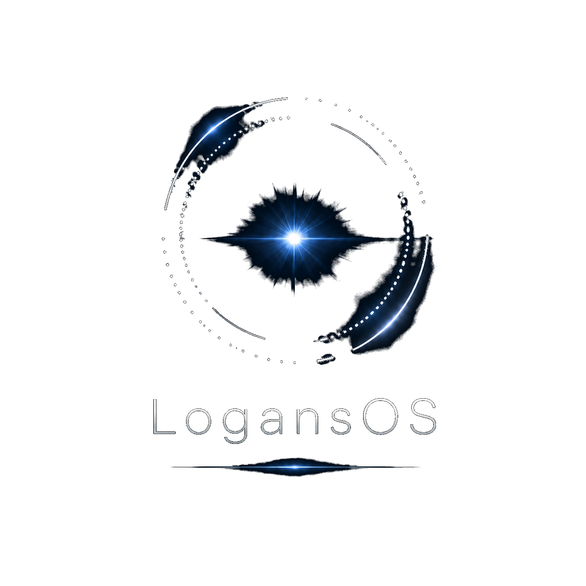

# LogansOS

  

> Intelligence as a kernel primitive.

AI-native operating system in Rust. Clean-slate, monolithic kernel, capability-secured, single-node, x86_64. Its
on-device assistant, **Arthur**, runs a real quantized LLM (Qwen2.5-0.5B-Instruct, Q8_0) through the kernel's own inference
syscalls, with no cloud and no telemetry, on the **Atrium** desktop.

> "AI-native operating system" in LogansOS's sense means AI-aware, not AI-driven: the kernel knows tensors, models, and inference contexts exist as distinct first-class objects (so it can arbitrate, isolate, account, and dedupe them); the kernel does not run AI to make scheduling decisions.

This is not a Linux derivative. It is not a Unix clone. It borrows ideas where ideas are good, but it owes no compatibility debt to POSIX, to the Linux syscall ABI, to ELF dynamic linking conventions, or to the assumption that a CPU is the privileged compute substrate.

## Try LogansOS in a VM

**The quickest way: the preview for Windows.** Download the zip from the
[`preview` release](https://github.com/SecondStageTurbine/LogansOS/releases/tag/preview), install QEMU once, and
double-click `Start LogansOS.bat`. Each preview is boot-checked before it's published. The longer guide is
[docs/HOWTO-try-logansos-in-a-vm.md](docs/HOWTO-try-logansos-in-a-vm.md).

**From source**, it boots the way an installed computer does: from its own disk, under UEFI, with no CD or USB. What
it writes (Arthur's memory, the intro you've already seen) is still there after a reboot. Build the two VM disks (the
product image and a data disk; the `.vocab` file must sit next to the `.neom`):

    docker compose run --rm neo cargo xtask vm-image --with-model <path/to/qwen2.5-0.5b.neom>

Boot them, then connect a VNC viewer to `localhost:5901`:

    docker compose run --rm -e NEO_SMP=4 -p 127.0.0.1:5901:5901 neo cargo xtask vm-run --vnc

Notes:
- The disks are `target/vm/boot.raw` and `target/vm/data.raw`.
- Running `vm-image` again replaces the boot disk and keeps the data disk. Add `--fresh-data` to start over.
- Without `--with-model`, `vm-image` takes the same options as `cargo xtask iso`. For example,
  `vm-image --features desktop` builds the desktop with no model.
- The firmware is the OVMF that the dev container's QEMU ships with, so no extra install is needed. To use another
  QEMU's, point `NEO_OVMF_DIR` at a folder holding `edk2-x86_64-code.fd` and `edk2-i386-vars.fd`.

## Status

**As of 2026-11-08.** The work runs in phases (the ledger is `docs/bible.md` Article 13): **0–4** the classic kernel
(boot, memory, scheduling, SMP, capabilities, the NeoFS filesystem, networking); **5–7** the AI subsystem; **7.5**
connectivity; **8** Arthur and the userland, which is active now. Where the AI substrate stands:
- **Phase 6** brought a kernel-managed `accel` driver class up on a real Intel UHD 630 GPU.
- **Phase 7** closed kernel governance of accelerator memory: it measures, arbitrates, owns and isolates, the last enforced by the GPU's own page tables.
- **Phase 7.5** brought up USB, USB-Ethernet, VT-d/IOMMU and WiFi crypto.

Releases are tiered (`Plans/DECISION-2026-10-27-release-tiers-mvp.md`):

| Tier | What it means | State |
|---|---|---|
| **0.1 "Arthur Preview"** | Boot on real hardware → a real desktop → talk to Arthur → online → your work persists | All five rungs have their code on `main`. **No single boot has shown all five together yet.** The showcase run on the OptiPlex 7080 is written (`Plans/RUNSHEET-2026-10-27-0.1-one-boot-showcase-optiplex.md`) but hasn't run. Until it does, 0.1 is *assembled*, not *demonstrated*. |
| **MVP (0.5)** | Something a person could use daily: install to disk, log in, a terminal, files, settings, a document editor, Arthur, wired networking, clean shutdown | In progress (see below) |
| **1.0** | Browse the internet, WiFi, sleep/wake, updates, media | Browser-gated, because an OS that can't browse isn't shippable |

**No single machine does everything yet.** This is the most important operational fact here:
- **The ASUS Zenbook S14** (the bare-metal target since 2026-10-21) has the desktop and Arthur, but no network lease and no NeoFS volume.
- **The Dell OptiPlex 7080** has the network lease and NeoFS persistence, and is the 0.1 showcase target.
- The RTL8125 driver's first run on real hardware (the MSI board) is pending.

**What works today, and where:**
- **On the Zenbook S14:**
  - it boots to the Atrium desktop;
  - the keyboard (i8042 and USB), touchpad (I2C-HID, found through the firmware's ACPI tables) and USB input work;
  - Arthur answers. "What's 2+2?" went from ~57 s to ~1.2 s of compute across the A6→A9 images, through HWP, a
    prebuilt binary vocabulary and parallel attention. (The binary vocabulary is the same full vocabulary, encoded so
    it needs no parsing at boot. It's lossless, and a host test proves it token-for-token identical to the text one.)
  - A block **write guard** makes it impossible for LogansOS to write the laptop's internal Windows disk (#83, #85, #88).
- **On the OptiPlex 7080:**
  - a real DHCP lease over USB-Ethernet on a product boot;
  - NeoFS persistence across a power cycle;
  - the Gen9.5 GPU running AI ops.
- **In the VM preview:** login with a password and a lock screen, the clock in your time zone (`timezone` in Home),
  key repeat, Arthur answering "what time is it" from the clock, and Shut down and Restart arriving now (OT-90).
- **In VMs only:** the installer (OT-87), behind the off-by-default `installer` feature. It installs to a blank disk
  that then boots on its own with Arthur's model loading from it (GPT and a FAT32 ESP, a power-cut-safe W0–W6 state
  machine, a one-shot install claim past the write guard).

**What's next:**
- **A first-boot setup menu**, Ubuntu-style ("Try or Install"): its design is merged (#64) and step 1 is in review.
- **The browser ladder (OT-61):** the C/C++ runtime, the rendering layer (SWGL) and POSIX threads are on `main`; Servo's
  page layout, without script, is running in tests; next is drawing a first static page to the screen, then script.
- **Terminal, file manager and settings apps** (surveyed; the terminal's pipes are landing).
- **Not started:** printing (post-1.0) and a document editor (MVP; a design comes first).

The release ledger is `Plans/LEDGER-2026-07-29-logansos-release-ledger.md`. Open obligations are in
`docs/OPEN-THREADS.md` and `docs/complexity-governance.md`. Feedback from testing the preview is tracked in
`Plans/FEEDBACK-2026-11-02-preview.md`.

### Recent activity

- **2026-11-02/08: J.c.'s preview feedback, fixed and shipped in two previews.** The clock in your time zone, key
  repeat, "Incorrect password. Try again.", Shift punctuation and the keypad, Arthur telling the time
  (`Plans/FEEDBACK-2026-11-02-preview.md`).
- **2026-11-01/03: a tiered CI gate for the free tier.** A quick tier on every PR, the full tier on each landing batch (OT-58, `docs/THINK-2026-11-01-ot58-tiered-gate.md`).
- **2026-10-27/28: the reviews earn their keep.** About 20 changes merged under "merge on green, review after"; the
  post-merge reviews found real defects no green run could, including a NeoFS crash-consistency bug checked against
  56,470 power-cut cases (#180), and twice a second model family broke a pass the first had given (Muse passed,
  Janus broke it). See `docs/concurrency-pitfalls.md` CP-87 to CP-92.
- **2026-10-26/28: the installer, rung by rung** (OT-87, R1 to R4.3; Muse's security review of the writes: PASS).
- **2026-10-21/25: the Zenbook S14 becomes the bare-metal target** (x2APIC, xHCI and i8042 input, an I2C-HID touchpad, RTL8125, a boot-time model preload).
- **2026-10-18/21: the Atrium desktop**, capability-native: no client can name, see or touch another's window.
- **2026-10-16/20: ring-3 hardening** (CP-38 to CP-50) **and Arthur's real model** as a hash-pinned boot module (#70, #71, #74).

Earlier activity (2026-08-11 and before)

- 2026-08-10/11: **two caveats closed.** The `product` build is now a blocking CI job (OT-78), and the 485 MB model file was verified byte-for-byte against its content hash offline (OT-73).
- 2026-08-07: **A scheduler bug that was nearly deleted, a diagnosis that closed the lane without writing code, and an uncomfortable pattern.** During a routine disk cleanup — reclaiming build trees after the 0.1 merges — a folder queued for deletion turned out to hold uncommitted work that existed nowhere else: a fix for a **permanent reservation leak** in the SMP scheduler, where a thread migrating between CPUs increments the destination's live-thread count and can fail to decrement the source's, drifting upward until the kernel refuses to admit new threads forever. Its author had written the failure mode down precisely — *"a silent hang, not a crash"* — and the code was one `rm -rf` from gone. It survived because the cleanup rule is mechanical rather than judgemental: **anything not already pushed gets pushed before its folder dies**, no matter how confidently it looks like a stale duplicate. Twice during that pass it looked exactly like one, and twice that was wrong.
  The diagnosis then went to a new kind of seat — one that answers a single hard question deeply rather than iterating — and it closed the lane **without any code being written**: the leak is *structurally unreachable*, because a thread's CPU id is only ever stamped to CPUs that have a scheduler installed, and schedulers are never torn down. It went further and refuted the framing itself: the test we suspected **never calls the leaking function at all** — its wakes route through a different path with no cross-CPU accounting. Two of the project maintainer's own hypotheses died in the process, one to a five-minute check on a build flag. A theoretical bug, correctly identified as theoretical, cost nothing to close.
  **The uncomfortable part is what the investigation kept finding.** Twice in one week, a question we were actively working on had already been answered in the repository — once in a runbook that recorded the exact failure mode and explicitly warned that the remedy we were reaching for wouldn't work, and once in a source comment that described the failure better than our fresh measurements did, including a controlled experiment nobody remembered running. The knowledge was banked correctly and simply didn't resurface when the same question came round again. That is now tracked as a problem in its own right, because a project that writes good notes and doesn't read them is paying twice for the same lesson.

- 2026-08-02: **All five rungs of LogansOS 0.1 "Arthur Preview" are on `main` — and the review apparatus mattered more than the code.** Eight lanes closed in one push: the desktop window manager and its scene policy, `eth0` at boot, NeoFS persistence on a product boot, the WiFi recovery path, the Gen9 EU allowlist, and the SMP threads/futex work. Every one cleared the same bar — CI gate green *and independently re-verified on the exact commit* (never a pasted link), the merge diff inspected for phantom deletions, and an **adversarial-audit panel** of independent reviewers each prompted to *refute* rather than confirm, drawn from a **different AI model family than the author** wherever the rule required it. **Six panels ran; four found real defects in code that was already fully green and clean-looking** — a desktop verb that let one client destroy another's window by naming it, a boot-time allocation that would have panicked on real hardware and bypassed every graceful-degradation path, a driver's retry authorization that no test actually exercised, and a GPU DMA path that was never contained at all. **None of the four was catchable by any automated gate we have.** The dominant defect class turned out not to be bad code but *assertions with nothing behind them*: a safety check that was a printed string, a hardcoded literal posing as a measurement, a CI job structurally incapable of reporting failure, a loop that could run zero times while printing "ok". Six instances, six subsystems, one day. That is the honest lesson of the milestone.
- 2026-08-02: **`eth0` comes up on a product boot — a real DHCP lease on real hardware, with no test scenario involved.** Rung 4. The kernel boots on the bare-metal OptiPlex, brings up a USB-Ethernet adapter through its own native init path, and obtains a genuine lease (`eth0: link up ip=<optiplex-ip> … fence_refusals=0`) — corroborated by the fact that it took the *same* address the control OS holds on that dongle, proving the DHCP client presented the correct MAC and the server honoured its existing lease. It took three boots, and the useful part is that **each failure diagnosed itself**: run 1 showed a link-notification veto over a physically live PHY; run 2 fixed the link but received *zero* frames, which is decisive on its own because a live LAN is never silent — that's an RX-arming problem, not a DHCP problem; run 3 passed. The adversarial review then confirmed the DMA-containment claim is real *by construction* — every device hand-off is fence-preceded — which is exactly the opposite of a sibling GPU driver found the same week where the fence was never called at all, meaning its "zero containment refusals" had been measuring nothing.
- 2026-08-02: **Work persists across a power cycle on a product boot.** Rung 5. NeoFS — a mature copy-on-write filesystem with a rotating superblock, writeback and crash recovery — is now mounted read-write on an ordinary boot rather than only inside a test, so something written before a reboot is readable after it. The build's own new test scenario immediately earned its keep by catching a **kernel panic before scheduler initialisation** that nothing else covered. The adversarial review then answered the question that mattered most — did removing a mount-time integrity check delete the only verification of the model weights? — with a traced *no*: a streaming block-by-block hash survives at read time, so the change removed a redundant-and-catastrophic full-file check (a ~485 MB allocation on a 4 MiB heap) and kept the correct one.
- 2026-08-02: **A real desktop: two windows, keyboard focus, and isolation enforced by grammar.** Rung 2. Two independent clients each own a text surface, the compositor routes keyboard input to exactly one of them, focus switches between them, and neither client can present directly to the screen. The security property is structural rather than policed: **no verb in the protocol can name, enumerate, restack, or sample another client's window** — anti-X11 by design. The adversarial panel found that rule enforced on only one of four verb handlers, which meant a client could destroy or commit a *peer's* surface by naming it (surface ids being sequential and guessable); the fix routes every verb through one identity check, closing the same latent hole in the pre-existing compositor too.
- 2026-07-31: **The CI blind spot: ~20,000 lines across 23 feature-gated subsystems were invisible to continuous integration.** The blocking lint ran default features only, so whole drivers behind `#[cfg(feature = …)]` were never compiled. Proven by falsification rather than argued: a deliberately planted syntax error in the WiFi driver survived a build reporting `Finished`. Worse, one accelerator subsystem **did not compile at all** in the configuration that actually ships — undiscoverable by any test, because every test enables a feature that pulls in the missing pieces. A non-blocking coverage job now compiles the gated surface; the debt it exposes is being paid down before the job is made blocking. Tracked as OT-69.
- 2026-07-31: **"Flaky" became a number.** Two CI scenarios were failing on first attempt roughly half the time while the summary showed green, because a retry wrapper hid it — a test that passes by retry is evidence the wrapper is generous, not that the code is correct. A log-scrape across 25 runs and 284 scenarios separated two problems that looked identical: one is a genuine **race** (completions cluster at ~7 s, failures pin at exactly the 420 s budget, nothing in between — a switch, not a distribution, so raising the timeout is useless by construction), and the other is **capacity** (a second, slower machine could never finish one scenario at all — 0 of 16 attempts). The slower host was removed from the test pool: a runner that deterministically fails a gate scenario isn't capacity, it's a chance of a false red on every run.
- 2026-06-20: **Rule-4 consolidation after OT-23/I-15/Arthur slices.** ADR-062 refreshes the I-1..I-15 ledger after CSPRNG 10.3, Arthur grant E1/E2/E3, file-cap unification, OT-23 XSAVE/YMM preservation, Arthur memory M1, and the M2/W2 design artifacts. Runtime behavior is unchanged; the only code consolidation is a private `grant_store.rs` no-alloc formatting helper shared by E2 and E3. OT-23/24/25 are closed and pruned from the active register; the next consolidation cadence now starts from ADR-062.
- 2026-06-14: **Phase 8 opens — building toward Arthur, the integral assistant.** LogansOS now commits to shipping an integral, on-device assistant — **Arthur** (Assistant for Real-time Tasks, Home automation, & User Requests): natural-language command of the machine plus capability-bounded autonomous action, realized in userland on the model-agnostic kernel substrate, on-device with no telemetry. This is a deliberate constitutional change (bible Article 23.1 *reversed*, new Article 29) — the original charter forbade a "system AI assistant" to guard against a surveillance-chatbot gimmick; the substrate built since (capability-bounded authority, kernel-governed model residency, on-device inference) makes an integral assistant defensible the way the original presumed impossible. The kernel stays model-agnostic and telemetry-free; Arthur is the userland assistant the substrate was built to serve. Phase 8 (inference maturity → the serving surface → userland) is the first build-out: the autoregressive decode loop, the KV cache wired to the residency governance, a tokenizer, and quantization so a real model fits. Honest status: the *substrate* is proven on silicon; Arthur is the committed *direction*, and the serving pipeline is now under construction — proven-vs-pending stated plainly. See `docs/VISION-logansos-to-jarvis.md`.
- 2026-06-14: **Phase 7.5 — WiFi supplicant crypto (WPA2 + WPA3/SAE) host-proven before the radio.** The dongle-independent slice of the WiFi work: a from-reuse WPA2/WPA3 key-management + EAPOL + CCMP + SAE library (vetted RustCrypto primitives, never hand-rolled), every layer asserted against *published* IEEE 802.11 / RFC known-answer vectors (not round-trip self-checks) — including the WPA3 dragonfly handshake over P-256, whose test vector was sourced raw from two independent reference implementations and cross-validated byte-for-byte. The hardest software in WiFi is proven against the standard's own numbers before the radio exists; the USB driver follows when the adapter arrives.

- 2026-06-13: **Phase 7.5 BUILD-B — the network stack now runs over a USB-Ethernet dongle on real hardware.** A CDC-ECM class driver plugs the USB host stack into the existing (Phase-4) network code through the device-agnostic interface it was built around — so with **zero new networking code**, the kernel pulled a real DHCP lease (<optiplex-ip>) and resolved DNS over a USB-Ethernet adapter on the bare-metal OptiPlex; a packet capture confirmed the full DHCP handshake and the follow-up ARP on the wire. The honest part of the story is the better part: eight blind iterations chased a confident, well-cited conclusion that the adapter's chip had "dead transmit hardware" — and it was wrong. It was two of *our own* bugs: a transmit header we'd added on a hunch that corrupted the frames, and a latent flaw in the Phase-4 DHCP client (it left the client-hardware-address field blank, which the QEMU emulator tolerated but a real router does not). A cheap "just send raw frames and capture them first" check — insisted on before committing to a multi-day rewrite — exposed the misdiagnosis in a single boot, and a one-line DHCP fix closed it. The lesson is now in the record: a confident "it's the hardware" call was our own bug, and the spec-pure confirmation before a big build is what caught it. Next: the IOMMU (VT-d) build, deliberately sequenced before the WiFi firmware arrives.
- 2026-06-11: **Phase 7.5 BUILD-A — the kernel now talks to USB hardware on a real machine.** The connectivity lane's first driver: an xHCI USB host controller brought up from scratch, and a minimal USB core that enumerates whatever's plugged into the physical ports. On the Dell OptiPlex it took three blind bring-up iterations — and every failure named its own cause in a single run rather than hanging mysteriously: iteration one took a page fault whose address arithmetic alone pinpointed that Intel's chipset parks a config-register chain just past the window the driver mapped; iteration two came fully alive with real interrupt delivery (something QEMU can't exercise); iteration three fully enumerated a real device on a root port (an Intel wireless/Bluetooth combo) through the full address-and-configure handshake. Critically, the DMA fence from the previous build **held on real device DMA — 47 buffer hand-offs, zero escapes** — so the fault-containment guarantee (a driver can't reach the kernel's governance memory) is now proven on silicon, not just in the emulator. Every DMA address the driver hands the controller is a typed, fence-checked value by construction — a raw physical address can't reach the hardware. Next: USB-Ethernet, where the existing network stack lights up over this new transport.
- 2026-06-11: **Phase 7 CLOSED · Phase 7.5 opens contained — BUILD-7.5-0 lands the fenced DMA arena.** Phase 7 (kernel governance of accelerator memory) formally closed: 16 builds, 16-for-16 green, the thesis proven on the production path (close report in `Plans/`). The connectivity lane (USB host stack, USB-Ethernet, Intel WiFi) opens under a rule set fixed *before* any driver exists: a driver fault must never be able to touch the kernel's governance state (invariant I-14). Its first build is the boundary itself — a fenced DMA arena where every buffer a connectivity driver can hand to hardware must live, enforced by a single unbypassable gate (`fence(addr,len) → FencedDmaAddr`, the only currency a driver can program a device with). The adversarial gate test threw 108 hostile addresses at it — including live kernel memory and a 100-address spray — with **zero escapes**, while every existing driver path stayed bit-for-bit untouched (the kill-switch proof). Honest scope: this fences *our own* driver bugs (the realistic class); a misbehaving device with its own DMA engine is only stopped by an IOMMU — that's the dedicated VT-d build, deliberately sequenced before the WiFi firmware blob arrives. Next: the xHCI/USB bring-up — the lane's first blind-hardware build.
- 2026-06-11: **Phase 7 BUILD-O2 — the production model-load path comes under governance; the Phase 7 spine is complete.** The last gap: the default model-load path registered every weight as a dedup candidate via a weak reference, which silently pinned it against reclaim. O2 re-keys the dedup registry onto the slot arena — a candidate is now just a map entry naming a slot, pinning nothing — so weights loaded the way production actually loads them are finally reclaimable when idle. The shared-copy invariant comes out *stronger*: ten tenants loading the same model still share one physical copy, and that copy can now be demoted under pressure and re-fetched **without breaking the share** — a second tenant's load finds the demoted copy (one allocation, not two), byte-identical, counted once, even while the copy is mid-migration (the probe parks and re-resolves). Both gates passed first-attempt; the whole original sharing/dedup family unchanged; zero new `unsafe`. **With this, every governance line and every policy decision reaches the production-default path: placed, evicted, retained, prefetched, moved in the background, deduplicated across tenants — all result-invariant, all capability-secured.** Next: the Phase 7 close report, then the Phase 7.5 connectivity lane (USB, WiFi — with the fault-containment invariant I-14 already in force).
- 2026-06-10: **Phase 7 BUILD-O1 (a+b) — model weights now come under the kernel's memory governance.** The ownership redesign that closes the Phase 7 spine. Until now, a process handle and a loaded model held their tensors directly, so the kernel had to treat their mere *existence* as in-use and could never reclaim them — meaning the proven policy layer governed only scratch intermediates, never the model weights that are the whole point. O1 fixes that with the textbook generational-slot-map pattern (the same one ECS game engines and high-speed packet pools use): handles now *name* a slot, the kernel *owns* the tensor, and using it mints a short-lived reference through the proven concurrency gate — so an idle weight is reclaimable and a mid-use weight is untouchable, by construction. On the gate, a loaded model's idle weights are demoted under another tenant's memory pressure and transparently re-fetched on the next inference, byte-identical, while in-flight weights are never moved (50 iterations, 4 CPUs). We claim no novelty in the data structure — only in wiring it to the migration reservation and the capability boundary. Honest boundary: the *default* model-load path still pins weights via dedup-candidate registration; the §9.7 dedup-to-slot re-key (next) brings that last path under governance too. Zero new `unsafe`. Next: the dedup re-key, then Phase 7 closes and the connectivity lane (Phase 7.5) opens.
- 2026-06-10: **Phase 7 BUILD-P4b — the kernel now manages accelerator memory *while it works*, like a mature OS.** The capstone of the policy layer: a background kernel daemon (the kswapd model) that, concurrently with live inference, demotes cold tensors and prefetches the data the next op will need — banking headroom *ahead* of the placement that needs it, so the critical path stops paying for reclaim. Measured 60 times at 4 CPUs: the same multi-tenant pressure pass that pays a stall for reclaim with the daemon paused pays **zero** with it awake — every single iteration — while 27,130 reads racing against 240 background migrations all came back byte-identical and the migration-reservation race protections (from P4a) demonstrably fired. It's strictly additive by construction: switch the daemon off and the system is bit-for-bit the previous build, with the synchronous reclaim path as an always-correct backstop (proven 60×). The residency trace now reads like a real memory manager — `placement: → eviction: → residency: RETAINED / cold-demote → bg-demote / prefetch`. **This closes the Phase 7 policy arc as designed: the kernel places work (P1), reclaims under pressure (P2), anticipates pressure (P3), makes concurrent movement provably safe (P4a), and moves memory in the background while it computes (P4b).** Next: a consolidation pass (per the project's complexity-governance cadence), then the device-side DMA-overlap hardware lift.
- 2026-06-10: **Phase 7 BUILD-P4a — moving a tensor while the system races to use it is now provably safe.** The policy layer's first true concurrency build: a migration-reservation primitive (claim → park → commit) that lets a background mover migrate a tensor between host and device *while another thread races to reference it* — the racing accessor parks on the reservation and re-resolves after the move commits, the same shape as Linux's page-migration entries. The proof is the point: a 60-iteration stress gate at 4 CPUs ran 240 migrations against a continuous accessor with **zero** inconsistent reads, **zero** byte divergences, perfectly balanced park/wake counts (no lost wakeup, ever), and exact accounting deltas throughout. Getting there took five gate runs, and every failure *diagnosed itself* — the new in-kernel lock-order checker (a lightweight lockdep) even caught a bug in its own first version, then caught two genuinely durable kernel lessons (a context-switch release racing thread identity, and an interrupts-off spin deadlocking against a preempted lock holder) that are now named in the code and ADR-039. Zero new `unsafe`: a tensor anything still references can never be claimed — the type system itself forbids moving what's in use. This is the foundation the next build's background residency daemon rides on. Next: P4b (the watermark-driven daemon that demotes and prefetches concurrently with live inference).
- 2026-06-10: **Phase 7 BUILD-P3 — the kernel now *anticipates* memory pressure instead of only reacting to it.** The proactive arm of the policy layer. Where P2 reacts to a full device, P3 makes two decisions *before* the pressure bites: it **retains** a tensor P2 would have evicted when a structural predictor (does the *next op* in the forward pass need it?) marks it hot — evicting it would only force a re-load next op, so a colder tensor goes instead; and it proactively **cold-demotes** idle tensors to bank a headroom margin, so the next placement avoids an eviction round-trip entirely. The new trace shows the kernel reasoning ahead: `residency: tensor=8 device=Accel(1) RETAINED reason=reuse-soon` / `tensor=7 → cpu reason=cold-demote`. On the gate, a workload that cost P2 two evictions cost P3 **zero** (it banked the room first), and a reuse pattern where P2 evicts the exact tensor the next op needs is correctly retained — both with **byte-identical** output. A deep-research pass (CUDA unified-memory oversubscription, Linux tiered-memory TPP/AutoNUMA, the Linux page-migration SMP protocol, LLM-serving offload) settled the design: this is the last reactive→proactive step the policy layer takes *without* concurrency — the cost model is in bytes only (the honest unit), the predictor is the op-graph (no learned model in the kernel), and concurrent movement is deferred to P4 where it can be made safe with a migration-reservation primitive. Next: P4 (concurrent residency — async prefetch/promotion under an SMP gate).
- 2026-06-08: **Phase 7 BUILD-P2 — the kernel now reclaims device memory under pressure (LRU eviction).** The second policy build: when placement wants a tensor resident on an accelerator that's *out of room*, the kernel decides which resident tensor to evict — least-recently-used among the *unpinned* ones — migrates it back to CPU to make space, and logs the reason (`eviction: tensor=3 device=Accel(1) → cpu reason=lru (resident=240KiB/256KiB, need=32KiB)`). Operands and outputs of the in-flight op are never evictable (pin-protected via live refcount), residency stays within capacity at all times, and if nothing evictable yields room the op falls back to CPU rather than thrash or fail. On the gate, a memory-pressure forward pass on a bounded device evicted the coldest tensors, stayed under capacity, touched no pinned tensor, and produced **byte-identical** output to the unbounded reference. The kernel now manages a *scarce* resource under pressure — eviction is the tensor-residency analogue of OS page reclaim. Next: cost-aware proactive migration (P3).
- 2026-06-08: **Phase 7 BUILD-P1 — the kernel now *decides* where AI work runs.** First build of the policy layer: before dispatching an op, the kernel consults its own placement policy — where do the operands already live, who's over quota, which device benefits — and routes the op there, logging the *reason* (`placement: op=Gelu → Accel(1) reason=operands-resident migrated=0`). On the gate, the policy ran a 4-op chain with **zero** tensor migrations where a naive fixed-device baseline incurred 3 — same exact output bytes. The logs now show the kernel *reasoning* about a resource, not just executing commands: the moment this stops looking like an inference engine and starts looking like an operating system managing intelligence. Next: eviction policy (P2) and cost-aware migration (P3).
- 2026-06-08: **Phase 7 BUILD-4X-3 — the kernel now isolates adversarial tenants *on the GPU itself*, enforced by silicon page tables.** With two tenants each in their own kernel-built GPU address space, a second tenant's attempt to read the first's tensor *page-faults on the hardware* (and a read-only shared tensor faults on write) — while each tenant's access to its own data succeeds. That's the last of the four governance lines: the kernel doesn't just *decide* who may touch a tensor, the **accelerator's own page tables enforce it**. All four — measure, arbitrate, own, isolate — are now real on hardware. The kernel governs AI between mutually-untrusting tenants, down to the silicon. *(This is the milestone the project's design was built to reach; the device-boundary work is closed.)*
- 2026-06-08: **Phase 7 BUILD-4X-2 — a tenant's tensor data now lives in the kernel's per-context GPU page tables, proven on silicon.** The Add computed `[4,6]` on the UHD 630 with its data buffers *removed from the global GPU address space* — so the only way the answer is right is if the GPU resolved the data through the kernel-built, per-context page tables. That's the positive half of the device-boundary line: one tenant's data is isolated in its own GPU address space. One step left (4X-3): prove a *second* tenant physically can't reach the first's data — the last of the four governance lines.
- 2026-06-08: **Phase 7 BUILD-4X-1 — a GPU context runs under the kernel's own page tables on real silicon.** The device-boundary work hit a wall (the legacy submission path can't give a process its own GPU address space on this chip — proven over 4 hardware runs), so a deep-research pass mapped the harder "execlist" path from prior art, and it landed: a compute context now runs on the UHD 630 with the *kernel-built per-context page tables* as its active address space — the foundation for hardware-enforced isolation between tenants on the GPU. Next: map a tenant's data into those page tables (4X-2), then prove one tenant can't reach another's (4X-3) — the last governance line.
- 2026-06-07: **Phase 7 BUILD-3 — global-view ownership; the governance thesis is now demonstrated.** The kernel sees and enforces that N processes reference *one physical copy* of an immutable tensor — explicit read-only capability sharing (an RO grantee that tries to write is denied `EPERM`) and automatic content-hash dedup when two processes load the same model weights. A per-process runtime can't know this and would re-copy. With this, three of the four governance lines are real — **measure, arbitrate (enforced), and own the global view** — so the kernel demonstrably *governs* AI between mutually-untrusting tenants, not just runs it. The last line (concurrent hardware-enforced isolation at the device boundary) needs the Intel PPGTT driver lift (BUILD-4).
- 2026-06-07: **Phase 7 BUILD-2L — the decision is now *enforced* on real inference.** The scheduler is wired onto the live syscall path: a real tenant's `sys_inf_run` genuinely *blocks* (parks off the run queue, not spinning) when another principal holds the device, and is woken when it's their turn — no busy-wait, no new unsafe. The cross-tenant decision went from demonstrated-in-a-test to binding real syscalls. That's the governance thesis's first fully-real instance. Next: BUILD-3 (capability tensor sharing/dedup).
- 2026-06-07: **Phase 7 BUILD-2 — the first cross-tenant decision.** The kernel's admission-control scheduler now defers one principal's inference for another's reservation/quota (`PID12 deferred — PID7 reservation active`), reading the BUILD-1 accounting for quota — both requests still complete, in policy order. It decides *order*, never interrupts (accelerators run to completion). Honest gap: the scheduler is proven in a multi-tenant scenario but the live inference syscall doesn't route through it yet — wiring that (block-on-defer / wake-on-admit) is next, and is what makes the decision bind real inference. Then BUILD-3 (capability tensor sharing/dedup).
- 2026-06-07: **Phase 7 open — BUILD-1 (accelerator accounting) landed.** The kernel now measures, per principal (process), how much of each accelerator each one uses — resident bytes + dispatch count, hooked at the driver/residency boundary, device-agnostic. It's the measurement floor for governance: you can't arbitrate what you can't measure. Measurement only, no decisions yet. Next: BUILD-2, the admission-control scheduler — the first cross-tenant decision.
- 2026-06-07: **Phase 6 COMPLETE — BUILD-4b-2 closed it on silicon.** A hardware-tanh GELU EU kernel runs on the Intel UHD 630 (its `math.exp` path CI-gated); a mixed transformer-block forward routes matmul/add/GELU to the GPU and layernorm/rmsnorm/softmax to `accel_cpu` fallback, within tolerance of host-f32; cpu↔device tensor migration round-trips clean. GELU is the first op whose GPU result diverges from host-f32 (by 1/2²⁴) — the tolerance machinery finally validated non-vacuously. The kernel now owns AI execution end-to-end: dispatch, residency, migration, inference invocation. Next: Phase 7 (the inference scheduler — kernel *governance* of accelerator work).
- 2026-06-07: Phase 6 **BUILD-4b-1 complete — the Intel GPU now runs matmul on bare metal**, with a generalized op dispatcher. `accel_intel`'s dispatch went from Add-only to a kernel-table router (`Add` | `Matmul`) on the proven 4a substrate; a finalizer-built stateless-A64 `matmul_f32` EU kernel lands, uncovered/oversize ops fall back to `accel_cpu`, and matmul holds within 2⁻¹² of host f32 (in fact 0 ULP — the Gen9 EU has no FMA, so it tracks host f32 bit-for-bit). Next: BUILD-4b-2 (remaining ops + forward-pass equivalence + tensor-migration → closes Phase 6).
- 2026-06-07: Phase 6 **BUILD-4a complete — a real Intel UHD 630 (Gen9.5) GPU computed `[1,2]+[3,4]=[4,6]` on bare metal** (Dell OptiPlex 7080), byte-exact (0 ULP). A GuC-free legacy-render-ring GPGPU path: GGTT-mapped DmaBuffers, `STATE_BASE_ADDRESS`, and a stateless-A64 indirect-data thread payload, brought up over eight bare-metal iterations.
- 2026-06-05: Phase 6 BUILD-3 complete — the custom `virtio-accel` device (a host vhost-user daemon + a kernel virtio-pci driver) runs the full tensor op set over real virtqueue/DMA/IRQ, byte-identical to the CPU backend.
- 2026-06-05: Phase 6 BUILD-1/2 landed — the `accel` driver class (the `AccelDriver` trait, `DeviceId` residency, explicit tensor migration), plus `accel_cpu` (the soft-float CPU reference backend) and `accel_sim` (an in-kernel async multi-device reference accelerator).
- 2026-06-04: Phase 5 complete — the AI subsystem foundation: the tensor primitive, the `.neom` model object, and a CPU inference backend running a `.neom` forward pass end-to-end (QEMU SMP + bare metal on a Dell OptiPlex 7080).
- 2026-05-30: Phase 4 complete — in-kernel network stack: IPv6, UDP, capability-secured sockets, kTLS-hybrid TLS.
- earlier: Phase 3 (NeoFS, block layer, AHCI/NVMe — bare-metal verified) and Phase 2 (capability security, SMP, buddy/slab allocators, advanced TLB) complete.

## What this project is

A clean-slate **monolithic** kernel in Rust with AI/ML treated as first-class kernel primitives. Specifically:

- The kernel exposes a tensor object as a kernel-managed primitive alongside processes, threads, and memory mappings (Bible Article 2.2).
- Accelerators (GPUs, NPUs, TPUs when present) are kernel-managed devices with first-class drivers, not userspace-hijacked PCIe BARs (Article 2.2).
- The CUDA/ROCm/Metal model where userspace processes own the accelerator is explicitly rejected (Article 2.3).
- The "AI is a service over a socket" model (LM Studio, Ollama, llama.cpp daemons) is explicitly rejected. Inference is a syscall family, not an IPC dance (Article 2.4).
- The OS ships an integral, on-device assistant — **Arthur** (Article 29) — but never a *surveillance* persona: no telemetry, ever, and no specific model embedded in the model-agnostic kernel (Article 23, amended 2026-06-14; Arthur is userland on the kernel substrate).

See `docs/bible.md` for the foundational charter.

## Common questions

### What does "AI-native" mean concretely?

Not "Linux with CUDA bolted on," and not "the kernel runs a chatbot." In this project, AI-native means the kernel ABI and security model are designed around AI workload objects instead of treating them as opaque userspace buffers:

- **Kernel-known AI objects:** tensors, models, inference tickets, streams, and accelerator tasks are planned as kernel objects with capability handles (Phase 5+). The kernel can arbitrate, isolate, account for, and eventually dedupe them.
- **Kernel-managed accelerator ownership:** GPUs/NPUs/TPUs are intended to be kernel-managed devices. Userspace does not own raw PCIe BARs or accelerator memory directly. DMA ownership, device memory, and mappings are mediated by kernel policy.
- **Tensor memory management:** tensor storage is designed as a first-class memory class. CPU-resident tensors may be mapped into userspace under capability rights; accelerator memory is not handed out as raw userspace mappings.
- **Scheduling and accounting hooks:** inference and accelerator work are designed to become schedulable/accountable kernel work. The current Phase 3 scheduler is still a general SMP kernel scheduler; inference-specific scheduling is Phase 7 territory, and training-specific scheduling is not implemented today.
- **Agent/service isolation by capability:** mutually untrusted AI services, tools, and agents share authority only by explicit capability grant/derive/revoke. There is no root user, global model namespace, or ambient "can inspect all tensors" privilege.

So the concrete answer is: yes, it includes kernel-level accelerator and memory-management design, but the deeper point is authority and isolation. AI workloads create valuable, shareable, dangerous objects; LogansOS makes those objects explicit kernel resources.

### What capability system is this?

It is a pragmatic custom capability table, influenced by seL4/CapROS-style capability discipline but not a CAmkES/seL4 proof-carrying system. There is no formal proof story today.

Implemented shape:

- Userspace sees dense per-process integer handles.
- The kernel maps each handle to an object variant, a kernel-private `CapId`, rights, and derivation metadata.
- Rights are split into uniform meta rights (`USE`, `DERIVE`, `GRANT`, `REVOKE`) and object-specific semantic rights (`SEND`, `RECV`, `KILL`, file rights, etc.).
- Capabilities can be derived with reduced rights, revoked through the derivation graph, and granted to another process through capability-mediated IPC.

This is intentionally more practical than formally verified microkernel capability systems, but it preserves the rule that holding the handle is the authority. The long-term AI object model extends the same mechanism to tensors, models, inference contexts, and accelerator tasks.

### What runs in userspace right now?

These run in userspace:
- `neo-init` (PID 1). It hosts the desktop session and window manager.
- `neo-atrium`, the desktop's design language and scene.
- `neo-text`, text layout.
- `neo-arthur`, the assistant.
- `neo-shell`.
- `neo-worker`, which also plays the Lens and other roles.
- `libneo`, the syscall, threading and sync library.
- `vault-core`, which holds secrets.
- A sealed Rust `std` port (`neoplutarch-std-overlay` and `neo-std-pal`), for the browser work.

**What's there:**
- a capability-native compositor, where no client can name or observe another's window;
- Arthur answering typed questions with a real quantized model, through the kernel's inference syscalls;
- a persistent filesystem that survives a power cycle.

**What's still missing:**
- an installer you can reach from the desktop (the engine exists, VM-only, and its UI is in progress);
- a first-boot setup menu (designed; step 1 in review);
- terminal, file manager and settings apps (surveyed);
- a document editor;
- printing.

### Is this a personal project or intended for deployment?

It is a serious long-horizon systems project, but not deployable software today. The work is verified in QEMU on every change and on real hardware (a Dell OptiPlex 7080 and an ASUS Zenbook S14) at milestones. Treat it as research-grade kernel engineering with a product-shaped north star, not something you should run production AI workloads on yet.

## What this project is not

- Not a Linux derivative, fork, or rebadge.
- Not a research microkernel demonstration. This is a usable system, not a paper.
- Not an "AI assistant OS" in the consumer-product sense.
- Not a unikernel or single-application appliance.
- Not a cloud-only OS. Bare metal first; virtualization is a guest scenario, not a host one.
- Not a POSIX-compatible system. A POSIX compatibility shim is planned for porting userland tools, but the native ABI is its own.

See `docs/bible.md` Article 3 for the canonical anti-scope.

## Quick start (Docker — recommended)

You'll need Docker Desktop (Windows/Mac) or Docker Engine + Compose (Linux). Nothing else — Rust nightly, QEMU, and the Limine bootloader all live inside the image.

One-time setup:

    docker compose build

Takes 5–10 minutes the first time.

Run kernel tests:

    docker compose run --rm neo cargo neo-test all

Boot in QEMU with VNC framebuffer:

    docker compose up neo-vnc

Connect a VNC client to `localhost:5901`.

Drop into a dev shell:

    docker compose run --rm neo

From the dev shell:

    cargo k             # build the kernel only
    cargo neo-tty       # build + run, serial console only
    cargo neo-vnc       # build + run with VNC :5901
    cargo xtask help    # see all xtask commands

## Roadmap

Per `docs/bible.md` Article 13:

- Phase 0 — Boot, framebuffer, serial. **Complete.**
- Phase 1.1 — GDT, IDT, basic interrupts. **Complete.**
- Phase 1.2 — Memory management, paging, frame allocator. **Complete.**
- Phase 1.3 — Cooperative + preemptive scheduling, kernel threads. **Complete.**
- Phase 1.4 — Userspace: SYSCALL/SYSRET, per-process page tables, ELF loader, first ring-3 process. **Complete.**
- Phase 1.5 — Multiple userspace processes, basic IPC, userspace heap, process termination, and pre-Phase-2 security consolidation. **Complete.**
- Phase 2 — SMP, capability system, buddy+slab allocators, advanced TLB management. **Complete.**
- Phase 3 -- NeoFS (content-addressed), block layer, real disk I/O, and VFS/filesystem expansion. **Complete.**
- Phase 4 — Network stack — dual-stack IPv6+IPv4 (IPv6-first), sockets-equivalent, kTLS. **Complete.** (USB stack + USB Ethernet were re-deferred to Phase 7.5 per ADR-017 §D3.)
- Phase 5 — AI subsystem foundation: tensor primitive, `.neom` model object, CPU inference backend. **Complete.**
- Phase 6 — AI accelerator drivers: the `accel` driver class (CPU, simulated, `virtio-accel`), then a real Intel GPU running matmul/add/GELU with mixed-precision CPU fallback + tensor migration. **Complete** (bare-metal verified, OptiPlex 7080).
- Phase 7 — Inference scheduler, multi-tenant model serving (kernel governance of accelerator work). **Complete.**
- Phase 7.5 — Connectivity/WiFi: USB host, USB-Ethernet, VT-d/IOMMU containment, MT7601U SoftMAC, WPA2/WPA3 client mode. **Code complete and merged; wired networking silicon-proven** (a real DHCP lease on a product boot). The WiFi driver's bare-metal LINK-UP remains an **open acceptance milestone** — the code is merged on gate + review, which makes no claim the radio works. See ADR-017 and ADR-054.
- Phase 8+ — Inference maturity and Arthur userland: the serving path, the Atrium desktop, persistent memory, authority UX, then the MVP userland (installer, login, apps, shutdown) and the browser. **Active.** The near-term target is LogansOS 0.1 "Arthur Preview": all five rungs are merged, and the single-boot showcase hasn't run yet. See `Plans/DECISION-2026-10-27-release-tiers-mvp.md` for the 0.1 → MVP → 1.0 tiers.
- Future compatibility roadmap — Linux personality first per ADR-023; Windows personality is a later strategic target after the Linux/graphics/audio/input substrate is real. See `Plans/PL-ROADMAP-MARKER-2026-05-25-windows-personality.md`.

Phases 5–7 are the AI-native phases that justify the project's existence.

## Repo layout

| Path | Purpose |
| --- | --- |
| `kernel/` | The kernel crate (`no_std`, Rust nightly, x86_64). |
| `userland/` | Userspace: `neo-init` (PID 1, desktop session and WM), `neo-atrium`, `neo-text`, `neo-arthur`, `neo-shell`, `neo-worker`, `libneo`, `vault-core`, and the sealed `std` port. |
| `tools/` | `xtask`, the build orchestrator (`cargo xtask help`), plus host-only logic-test crates (KATs, byte oracles, cut models) that pin kernel logic. |
| `assets/` | Branding (the logo and boot emblem), fonts (Inter, IBM Plex Mono) and third-party licenses. |
| `third_party/` | Vendored permissive code, each with its upstream URL, commit and license: `acpi-loganfy` (AML), `fatfs` (host-side ESP builder). |
| `fixtures/` | Captured real-hardware data used as test oracles (ACPI tables from 10 machines, desktop pixel references). |
| `boot/` | Limine bootloader config. |
| `docs/bible.md` | The project's foundational charter. **Read this first.** |
| `docs/ADR-NNN-*.md` | Architecture Decision Records (the durable design log; 80 files). |
| `docs/THINK-*.md` | Design documents written before a build (installer, login, shutdown, desktop). |
| `docs/specs/` | Technical specifications (ANSPEC-NNN, the NeoFS format, etc.). |
| `docs/concurrency-pitfalls.md` | The SMP pitfall bank (CP-1 onward) every concurrency change is checked against. |
| `Plans/` | Working artifacts: dispatches, reviews (RETURNs), the release ledger, decisions. Closed-phase history is under `Plans/archive/`. See `Plans/INDEX.md`. |

> **Where the knowledge lives.** The repo carries far more `.md` than `.rs`, but that
> is mostly *process trail*: ~85% of the markdown is closed-phase dispatches and
> evidence parked under `Plans/archive/`. The **durable** knowledge base is a tight
> set — `docs/bible.md`, the ADRs, the THINKs, and `docs/specs/`. Read those (start with the
> Bible); treat `Plans/` as the audit log of how the work got done, not as docs.

## Why?

Every existing OS treats AI as a feature bolted on top: an app, a service, a sidebar. LogansOS treats intelligence as a kernel-blessed primitive — like memory, like CPU time, like a file handle. Apps make a syscall. The OS handles scheduling and protection. The actual matmul happens in driver code, accelerator firmware, or a dedicated kernel inference module — but the kernel knows it is happening and to whom.

Local-first by structure. No telemetry, ever (Bible Article 23.2).

## Status caveats

Phases 5, 6 and 7 are complete and silicon-proven as described above. The active caveats are deliberately kept in the open, in `docs/OPEN-THREADS.md`:

- **0.1 is assembled, not demonstrated.** All five rungs are merged, but no single boot has shown them together yet.
- **No one machine does everything yet** (see Status above).
- **Two hardware proofs are outstanding and aren't claimed:**
  - the WiFi radio's bare-metal LINK-UP (now a 1.0 item);
  - GPU execution-unit byte-equality on the Gen9 test machine, which isn't available.
- **The installer is VM-only**, behind an off-by-default feature, until its UI and the post-merge review fixes land.
- **One test scenario race is still open** (OT-74, the `threads_futex` half). Its other half was root-caused and fixed.

## Name

LogansOS is named after the PL's son, Logan. It was earlier "AltimitNeo", then "NeoPlutarch"; older `Plans/` artifacts keep those names as historical record. The full story is in `docs/bible.md` Article 25.1.

## Troubleshooting

`docker compose build` fails on the rustup step:
Usually a transient network issue with `sh.rustup.rs`. Re-run `docker compose build` — Docker layer caching means you won't redo earlier steps.

VNC connects but the screen is black:
The kernel might have panicked before reaching the framebuffer init. Check the QEMU console output (the terminal where you ran `docker compose up neo-vnc`) for kernel diagnostics. The serial log will say what happened.

`cargo neo-vnc` says `failed to launch qemu-system-x86_64`:
You're running it on the host instead of inside the container, and QEMU isn't on your PATH. Either install QEMU or use `docker compose up neo-vnc` instead.

Build is incredibly slow on Windows:
File I/O across the Docker Desktop boundary is slower than native. Most of the time you'll only feel this on the first build of a fresh checkout; cargo's incremental cache makes subsequent builds fast.

## License

Per ADR-026: **source code is MPL-2.0**, **documentation is CC-BY-4.0**.

- **Code** (`kernel/`, `userland/`, `tools/`, `tests/`, and all Rust/build sources) — Mozilla Public License 2.0. File-level copyleft: modifications to our files return to the commons, but the license does not attach to applications that merely run on or link against the system. Canonical text in `./LICENSE`; every source file carries `SPDX-License-Identifier: MPL-2.0`.
- **Docs** (`docs/`, `Plans/`, project-authored root `*.md`) — Creative Commons Attribution 4.0 International (CC-BY-4.0), so the Bible, ADRs, and ANSPECs stay freely quotable with attribution.

See `./LICENSE`, `./NOTICE`, and `docs/ADR-026-license-mpl-2.0.md` for the authoritative terms and rationale.

· · ·

 

> *"Prove it, then we'll talk."*
>
> LogansOS, drawn as a caricature: a rust-skinned magistrate-librarian governing a court of leashed tensors, the Invariant Ledger (*One Page, Do Not Exceed*) chained to his wrist — every row stamped **PROVEN ✓** or, honestly, *designed-for, not measured*. **Human Patience: designed-for, not measured.** The IOMMU works the door. The discriminator insists every failure name itself before anyone panics. The throne is a beige OptiPlex 7080 — *Humble. Proven. Enough.* And there's a crayon drawing of Logan in the breast pocket, which is the whole point.

