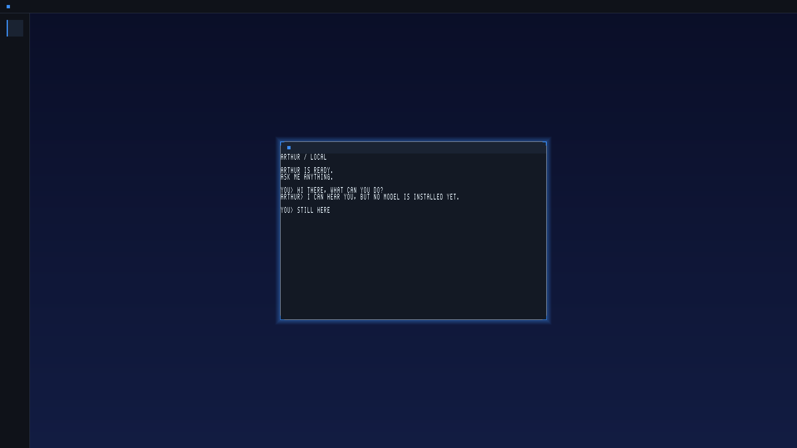

<!-- SPDX-License-Identifier: CC-BY-4.0 -->
# How to run the LogansOS desktop on your PC

This starts LogansOS in a virtual machine on your Windows PC and shows its
desktop in a window. You can type to Arthur with your real keyboard.



## What you need (one time)

1. **Docker Desktop for Windows.** Download it from docker.com, install it,
   and keep the default "Use WSL 2" option ticked. Start it once and wait until
   it says the engine is running.
2. **A VNC viewer.** This is the window that shows the desktop. TigerVNC
   Viewer or RealVNC Viewer are both free. Install either one.
3. **This project on your disk.** You already have it if you are reading this
   file in the project folder.

## Start the desktop

1. Open the project folder in File Explorer.
2. Click the address bar, type `powershell`, and press Enter. A blue
   PowerShell window opens in the project folder.
3. Type this and press Enter:

   ```
   powershell -ExecutionPolicy Bypass -File scripts\run-desktop.ps1
   ```

4. Wait. **The first time takes a while** (it builds everything). Later starts
   are much faster.
5. Your VNC viewer opens by itself when the desktop is ready. If it does not,
   open your VNC viewer yourself and connect to `localhost:5901`.

## Use it

- You will see a deep blue sky with soft light, a frosted-glass bar along the
  top, the frosted **Spine** down the left side, and **Arthur's window** in the
  middle with a soft blue glow. The glow means Arthur has your keyboard.
- Click inside the VNC window so it has your keyboard, then type a question and
  press Enter.
- If no AI model has been installed yet, Arthur replies that it can hear you
  but has no model. That is expected. Typing still works.

## Stop it

Go back to the PowerShell window and press **Ctrl+C**. Closing the VNC viewer
alone leaves the virtual machine running in the background.

## Start again with a clean slate

Arthur keeps a small memory disk between runs. To wipe it, start with:

```
powershell -ExecutionPolicy Bypass -File scripts\run-desktop.ps1 -FreshDisk
```

## Turn the glass off

If the see-through glass makes things hard to read, start with:

```
powershell -ExecutionPolicy Bypass -File scripts\run-desktop.ps1 -ReduceTransparency
```

The bar, Spine and window frame become solid. Everything else works the same.

## If something goes wrong

| What you see | What to do |
|---|---|
| "Docker is not installed" | Install Docker Desktop (step 1 above). |
| "Docker Desktop is installed but not running" | Start Docker Desktop, wait for "Engine running", try again. |
| The VNC viewer says it cannot connect | The desktop is still building. Wait a minute and connect again to `localhost:5901`. |
| Typing does nothing | Click inside the VNC window first so it has your keyboard. |
| Everything is slow | That is normal for a virtual machine with no graphics card. Closing other heavy programs helps. |

## For developers

The same thing without Docker, on a Linux machine or inside WSL with QEMU and
Limine installed:

```
cargo xtask run-desktop             # opens a QEMU window (1920x1080)
cargo xtask run-desktop --vnc       # VNC on :5901 instead
cargo xtask run-desktop --resolution 1280x800
cargo xtask run-desktop --monitor 4444   # QEMU monitor on 127.0.0.1:4444 (screendump)
cargo xtask run-desktop --reduce-transparency   # opaque Atrium chrome (a11y floor)
cargo xtask run-desktop --classic   # the S1 chrome, glass compiled out
cargo xtask run-desktop --home      # DS-1: boot into Home's intent field
```

With `--home` the desktop starts at **Home**: a glass intent field in the
middle of the screen holds the keyboard (the window manager reads only its
*own* focus, never a client's). Type a question and press Enter: Arthur opens
and answers it. Press **Esc** in Arthur to go back to Home — Arthur stays
alive (a dot under its Spine chip says it is held); your next question goes
to the same Arthur. **Tab** moves the keyboard between the field and the
Arthur chip; Enter on the chip brings Arthur back. (Esc is a request Arthur
honours: a stuck app could keep the keyboard until the kernel escape key of
DI-1 lands — see `docs/THINK-2026-10-18-ds1-home-spine-shell.md`.)

The default material is the S3 Atrium glass (`neo-init` feature
`desktop-glass`, crate `userland/neo-atrium`). Reduce Transparency is selected
at build time by `--reduce-transparency` (feature `reduce-transparency`) or at
boot by the presence of the NeoFS file `/neofs/atrium-reduce-transparency`; the
WM logs `DESKTOP material=… cause=…` either way. `NEO_DESKTOP_MATERIAL`
(`glass` / `reduce-transparency` / `classic`) sets the default for the Docker
path.

`run-desktop` builds the kernel with the `desktop` feature set (`product` +
`desktop-session` + Arthur's inference substrates), neo-init as the resident
session compositor/window manager, and Arthur as its client. It pins the
framebuffer to 1920x1080 in the staged `limine.conf` (the window manager lays
out for whatever size the firmware actually gives it), attaches a USB keyboard
and mouse on a qemu-xhci controller, and keeps Arthur's NeoFS disk at
`target/desktop/neofs.raw`. Set `NEO_STAGE_B_NEOM` (a Qwen2.5-0.5B `.neom`) or
`NEO_STAGE_B_GGUF` and pass `--fresh-disk` once to give Arthur a model.
`NEO_SMP` sets the CPU count (default 4).

The gate scenarios are `cargo xtask neo-test desktop_home_boot
desktop_glass_boot desktop_glass_rt_boot desktop_session_boot` (the last is the glass-off S1
witness). Host oracles: `cargo test -p neo-atrium`; the independent scene
oracle is `scripts/desktop/scene_oracle.py`.

**Power-off and restart (OT-90).** The desktop has no Power item yet; the
mechanism lives behind the kernel feature `power-control`, which the desktop
build doesn't enable until the Power item lands (THINK
`docs/THINK-2026-10-27-ot90-shutdown-restart.md` §11, P4-P5). When it does,
mind the QEMU flags: `run-desktop` passes `-no-reboot`, so a power-off closes
QEMU and so does a restart (it doesn't reboot in place); plain `cargo xtask
run` passes `-no-shutdown`, so there a power-off **pauses** QEMU instead of
closing it. The gate scenarios are `cargo xtask neo-test ot90_s5_exits_qemu
ot90_restart_second_boot ot90_restart_fallback_i8042 ot90_kill_switch_off`;
xtask judges them by QEMU's QMP report of why it stopped.
