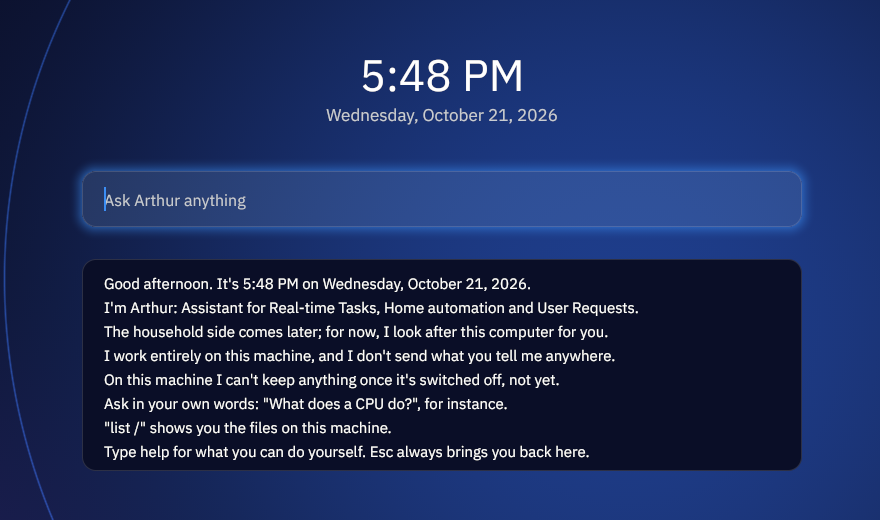

<!-- SPDX-License-Identifier: CC-BY-4.0 -->
# FINDINGS: the wall-clock rung — RTC epoch + Atrium time (OT-85)

**Author:** S4 (Claude). **Date:** 2026-10-21. **Branch:** `claude/wallclock-rtc-atrium` (PL merge reserved).
**Plan:** `Plans/NOTE-2026-10-21-wallclock-plan-s4.md`.
**Intro wording:** `Plans/NOTE-2026-10-21-wallclock-intro-s4.md`, which supersedes NOTE-2026-10-20's "Good day".
**Review:** `Plans/DISPATCH-2026-10-21-wallclock-codex-review.md` (cross-family; the writer is Claude).

## What was built

| Piece | Where | Kill-switch |
|---|---|---|
| RTC epoch seed: MC146818 through 0x70/0x71, once at boot | `kernel/src/arch/x86_64/rtc.rs` (I/O, write-once state), `rtc_logic.rs` (pure) | kernel `rtc-epoch`. Off: C1.0, with realtime boot-relative and the RTC/FADT never read. On in the shipping `desktop` set only. |
| FADT `CENTURY` + `IAPC_BOOT_ARCH` bit 5 "CMOS RTC Not Present" | `kernel/src/acpi/rtc_fadt.rs`, `rtc_fadt_logic.rs` (pure) | as above |
| `CLOCK_REALTIME` = monotonic + base | `syscall.rs` `sys_clock_gettime_impl` (one `cfg` block on the realtime branch) | as above. No new syscall, no ABI change. |
| Fallback test hook | `rtc-epoch-force-invalid` (every register reads 0xFF) | test only |
| Epoch → civil (date, weekday, 12-hour) and its text | `userland/libneo/src/civil.rs`: no allocation, no syscall, one formatter for probe and display | pure library |
| Clock words: greeting by hour, intro row | `userland/neo-atrium/src/clock.rs`, `intro.rs` `intro_lines_now` | pure |
| Home readout (time over date, on the backdrop) | `neo-atrium` `layout.rs` `clock_box`, `scene.rs` `set_clock` | not drawn until `set_clock`. Off ≡ bit for bit (KAT). |
| WM: readout, minute refresh, time-aware intro | `neo-init/src/desktop_session.rs` `mod clock`, `intro::intro_rows` | neo-init `desktop-clock` (in the product image). Off: Home and the intro exactly as before. |
| Gate | three scenarios, `scripts/desktop/clock_oracle.py`, host KATs (below) | — |

**The read protocol.**
1. FADT first: "CMOS RTC Not Present" means a named fallback. The century index is taken unless the FADT is
   hardware-reduced.
2. Then, with interrupts off, snapshots of the whole register file, each taken after UIP (register A bit 7) reads
   clear. The UIP wait is bounded at 100 000 polls; a timeout is the `uip-stuck` fallback.
3. The read stops at the first two consecutive identical snapshots, at most 8 reads, else `unstable`.
4. Decode honours register B: bit 2 binary/BCD, with nibbles above 9 refused; bit 1 24/12-hour, with bit 7 of
   the hour as PM.
5. Register D's VRT clear means `power-lost`.
6. Every field is range-checked, and dates that do not exist are refused. The year must be in 1970..=2199, so
   realtime in ns stays a positive `i64`.
7. The century byte is used only if it reads 19..=21; otherwise 2000 + yy (see the trap below).
8. `days_from_civil` gives Unix seconds; base = seconds·10⁹ − the monotonic ns at the read.
9. The base is stored, then `STATE = SEEDED` (Release). A query loads `STATE` (Acquire), then the base.
10. Every failure leaves the base at 0, i.e. boot-relative realtime, logs exactly one line
    `[ kernel ] rtc: fallback reason=<…> realtime=boot-relative`, and returns. The boot is never blocked.

**The WM shows only a real epoch.** It reads realtime and monotonic inside one tick. If they are equal (no
`rtc-epoch`, or a fallback), it shows no readout and keeps NOTE-2026-10-20's "Good day" intro. A failed RTC
therefore never shows "Thursday, January 1, 1970".

## The RTC is local time (decided)

The Zenbook dual-boots Windows 11, which keeps the RTC in local wall time. LogansOS reads it the same way and
never writes it, so the two systems cannot fight over the clock. The stored epoch is "the wall time the RTC
reported", counted as if it were UTC seconds since 1970. `libneo::civil` formats it with no offset, so the
display shows exactly that wall time. There is no time-zone database, no DST rule, and no UTC offset anywhere.
A consequence to keep in mind: `CLOCK_REALTIME` is **local** time, not UTC. Anything that later needs UTC
(TLS validity, NTP) must add an offset source first (OT-85 follow-up (c)). This is stated in `rtc.rs`,
`rtc_logic.rs` and `civil.rs`.

## Gate results (local QEMU 8.2.2, TCG; the 4-shard CI gate is the PM's to dispatch)

| Item | Result | Evidence |
|---|---|---|
| 1. Pinned-RTC battery (`wallclock_rtc`, `-rtc base=2026-10-21T17:48:00`) | **PASS** | serial below |
| 1. Atrium readout, same date and time (`desktop_clock_boot`) | **PASS** | serial and capture below |
| 2. Monotonic untouched | **PASS** | `vm_primitives` PASS; probe: 5 ticks nondecreasing; the diff touches only the realtime branch |
| 3. Fallback proven (`wallclock_rtc_fallback`, control `wallclock_rtc`) | **PASS** | serial below |
| 4. Persona and civil KATs | **PASS** | `cargo test -p neo-atrium` 63 passed; `-p rtc-logic-tests` 29 passed |
| 5. Default build unchanged; kill-switch | **PASS** | `vm_primitives` check 5; `desktop_intro_boot` and `desktop_home_boot` (fixtures unchanged) PASS; `rtc-epoch` not in `default` |

**`wallclock_rtc`.** The kernel read QEMU's RTC 4 s after the pinned base. The probe formats the boot instant
through `libneo::civil`:

```
[ kernel ] rtc: seeded wall=2026-10-21T17:48:04 as=local mode=bcd/24h century=0x32 reads=2 base_ns=1792604884000000000
[ wallclock ] base_ns=1792604884000000000 spread_ns=0 ticks=5 monotonic=nondecreasing
[ wallclock ] boot date="Wednesday, October 21, 2026" time="5:48 PM"
[ wallclock ] now realtime_ns=1792604884190000000 date="Wednesday, October 21, 2026" time="5:48 PM"
[ wallclock ] PASS: boot instant = pinned RTC (Wednesday, October 21, 2026, 5:48 PM)
```

- **Within one tick.** The base (realtime − monotonic, read between two equal monotonic reads) did not move at all
  across five ticks: `spread_ns=0`; the gate bound is ≤ 10 ms.
- **Host check.** xtask re-derives every logged value with its own `civil_oracle`, which walks whole years and
  months and shares no code with libneo or the kernel. It also checks the seeded wall time lies in the pinned
  minute and the base is that instant less under a minute of boot.

**`desktop_clock_boot`, the same pinned RTC.** The WM logs the probe's boot instant, then the readout it drew:

```
DESKTOP clock boot date="Wednesday, October 21, 2026" time="5:48 PM" base_s=1792604884
DESKTOP clock shown date="Wednesday, October 21, 2026" time="5:48 PM" realtime_s=1792604887
DESKTOP intro clock row="Good afternoon. It's 5:48 PM on Wednesday, October 21, 2026."
DESKTOP intro shown variant=ready usb=1 rows=8 persistent=0
DESKTOP clock readback box=642,285,720,84 ink_pixels=1773 masked=clock_box
DESKTOP readback full_screen=1920x1080 material=glass_home_hint_clock oracle=scene_oracle.py digest=0x955601f4e0c776d4 …
NEO_TEST/1 event=PASS name=desktop_clock_boot …
```

- **Scene evidence, captured in that run** (`docs/screenshots/desktop-ot85-clock-intro.png`, a crop of the QEMU
  framebuffer at the intro step):

  

- **What is held to the oracle.** Both captures (the eight-row intro, and the help card at the end) and the
  kernel's readback of the final Home are held to `scripts/desktop/clock_oracle.py`. That script renders the
  clock-less scene with `scene_oracle.py` and masks only the label, card-text and readout boxes. The readout
  therefore provably draws nothing outside its box, and the box has ink.
- **What is held to the host oracle.** The readout's words and the greeting row are checked against the host's
  independent civil oracle. The greeting word must also match the hour.
- **What is not.** The words inside the box are not pixel-pattern-checked: they change by the minute.

**`wallclock_rtc_fallback`.** The forced-invalid RTC is a 0xFF bus. The real validator refuses it, there is
exactly one line, the boot completes, and realtime == monotonic:

```
[ kernel ] rtc: fallback reason=out-of-range realtime=boot-relative
[ wallclock ] base_ns=0 spread_ns=0 ticks=5 monotonic=nondecreasing
[ wallclock ] realtime=boot-relative realtime_ns=180000000 monotonic_ns=180000000
[ wallclock ] PASS: fallback keeps boot-relative realtime
```

**`vm_primitives`, the kill-switch regression** (`rtc-epoch` off): new check 5 logs
`clock: realtime == monotonic (boot-relative, rtc-epoch off) ok`, and the battery passes.

**CI.** Push CI and the 4-shard `workflow_dispatch` run URLs go in the PM gate report. The PM dispatches the
gate on the head SHA. Local runs are not the gate (CLAUDE.md §close-gate).

**Hermeticity.** QEMU's default RTC is the host's UTC time, which is a host-variable input. Since `rtc-epoch`
is in the `desktop` set, every desktop scenario's kernel now seeds from it. A local `desktop_intro_boot` run
before the fix seeded `22:43:09`, the host's clock; nothing in that scenario reads realtime, so it still passed.
xtask now pins `-rtc base=2026-10-21T17:48:00` for **every** gate scenario, not only the three wall-clock ones,
so no gate outcome can depend on when or where it runs. Interactive `run` / `run-desktop` keep the host's time.

## Host KATs (byte-oracle rule: hand-computed values, independent of the code)

- **`tools/rtc-logic-tests`** (29). It mounts the kernel's `rtc_logic.rs` / `rtc_fadt_logic.rs` and libneo's
  `civil.rs` by `#[path]`.
  - Day numbers counted by hand from year lengths: the epoch = 0; 2000-01-01 = 10 957; 2000-02-29 exists;
    2100-02-28 is followed by 03-01; 2024-02-29; month and year ends; 2026-10-21T17:48 = 1 792 604 880; the
    weekday.
  - MC146818 register images: QEMU's BCD/24h; binary; 12-hour with the PM bit; 12 AM / 12 PM; bad BCD; dates
    that do not exist; the 0xFF bus; all-zero (power lost); the unmaintained century byte.
  - The agreement loop: stable, retry, unstable after exactly 8 reads, stuck.
  - Hand-laid FADT bytes: QEMU's q35 values; bit 5; hardware-reduced; revision 1; short tables.
  - The civil texts: the epoch, the pinned instant, the 5:48 → 5:49 edge, the 12-hour clock, the longest texts.
  - A kernel↔libneo calendar round trip over every day 1970..=2199.
- **`neo-atrium`** (63, +7 new).
  - The persona KAT over every model state × USB-only × all 24 hours, with the longest texts.
  - The greeting hour table.
  - The readout box geometry, hand-laid at 1920×1080 and 1280×800.
  - Clock-off ≡ bit for bit (Home and window).
  - With the clock on, ink only inside the box; a minute repaint of the box equals a full paint; Window → Home
    lands on Home.
  - Equality with `clock_oracle.py`'s digests (Glass and RT, hint / intro / help).

## Standing-rule notes

- **Pitfall bank (CP-*)**:
  - **CP-11 / CP-17 (ordering, publication before ready):** guarded. The base is stored before the Release store
    of `SEEDED`, the reader does an Acquire load of `STATE` first, and the base is never read unless seeded.
  - **CP-13 (torn multi-word read):** N/A. The base is one `u64`, written once before publication.
  - **CP-2 (spin IF-off on an interrupt-released resource):** N/A. UIP is cleared by the chip, not by an
    interrupt.
  - **CP-64 (long IF=0 while shootdown-ready):** N/A. The seed runs on the BSP before the APs start, and its IF=0
    window is bounded by `MAX_READS × UIP_POLLS`.
  - **CP-58 / CP-59 (a periodic rescuer hiding a missing wake; a hidden spinner):** the minute deadline is a real
    timeout on the WM's own park. It adds at most one wake a minute, and the input items it waits on are
    unchanged. The parked idle scenarios do not enable the clock.
- **I-14:** no lock of any kind; the seed and the query are atomics only.
- **W^X:** no mapping is touched.
- **Disk writes:** none (the #85 write-guard is unaffected).
- **QEMU vs. the datasheet:** no disagreement observed. QEMU's mc146818rtc reports BCD/24-hour (B = 0x02), VRT
  set, and FADT century 0x32; the first two snapshots agreed (`reads=2`). The battery proves the datasheet behaviour through
  the host KATs (12-hour, binary, UIP and stability paths), which QEMU's default mode does not exercise.
- **Trap mined (prior art, principle only):** firmware that names a FADT century byte but never maintains it (a
  stale 0x00 / 0x19, or a non-BCD byte). As first written, that would have thrown away a good clock. It is now
  ignored (2000 + yy) unless it reads 19..=21, with a KAT.
- **No GPL code.** The MC146818A datasheet and ACPI 6.5 were read for principle; the civil arithmetic is the
  textbook era/day-of-era method, written here.

## Known limits

- **No gate run crosses a live minute boundary.** The session's readout was drawn at 17:48:07 guest time, and
  the run logged no `DESKTOP clock minute` line. The minute tick's repaint is host-KAT'd (box repaint ≡ full paint), and
  its deadline arithmetic is in the review checklist (6a). A deterministic live-tick scenario would need a
  guest-time hook.
- **The product WM does not park** (`desktop-full` has no `desktop-park`), so Home spins as it did before. The
  clock adds one monotonic read per spin turn and reads realtime only past the minute deadline. Under
  `desktop-park` it is one wake a minute.
- **One second of RTC granularity.** The base is accurate to the RTC's second (the read can land anywhere inside
  it). This is fine for a minute display; it is not a time source for anything finer.

## Follow-ups (logged as OT-85 in `docs/OPEN-THREADS.md`)

1. **Zenbook bare-metal RTC proof (in person, PL).** Boot the product ISO after Windows has set the clock. Expect:
   - `[ kernel ] rtc: seeded wall=<Windows' time> as=local` on the fb progress console / NVMe sink;
   - the Home readout matching the Windows clock to the minute.

   If the laptop's FADT sets "CMOS RTC Not Present", the named fallback line shows instead, and follow-up 2 is
   the path.
2. **UEFI `GetTime` / ACPI TAD (`ACPI000E`)**, a second time source for hardware-reduced platforms with no CMOS
   RTC. Not implemented: it needs UEFI runtime-services mapping, or AML for TAD.
3. **UTC / offset storage**, only if a UTC source (NTP) lands.
