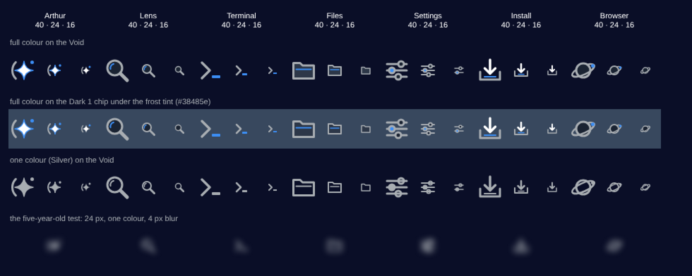
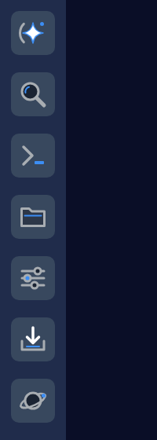

<!-- SPDX-License-Identifier: CC-BY-4.0 -->
# THINK: the first LogansOS app icons, S1's set (Claude family)

S1's half of the two-seat icon pass (`Plans/DISPATCH-2026-10-29-icon-design-pass.md`). Jarvis (Codex) draws the other
set independently; I did not read his branch before pushing this. J.c. picks.

Files, all under `docs/design/icons-2026-10-29/s1/`:
- `svg/<name>.svg`: the 40×40 masters.
- `svg/<name>-24.svg` and `svg/<name>-16.svg`: the hand-hinted small sizes.
- `svg/<name>-mono.svg`: the one-colour masters.
- `sheet.png`: the contact sheet.
- `spine.png`: the Spine mock.

## The idea, in three sentences

Every icon is one object a child could name: a spark, a magnifier, a prompt, a folder, sliders, an arrow into a tray,
a planet. Each is drawn in Silver structure with one small touch of Electric Blue, where light would fall on the
object. No two share a silhouette, and none is a tile: the chip is the frame, so the icons sit in it as shapes, the
Kare way, not as rounded squares.

## The icons

| Icon | Silhouette | Its light (Electric Blue) | Why it can't be confused with the other six |
|---|---|---|---|
| **Arthur** | A four-point spark with concave sides, beside one open arc on its left; a small dot at upper right. | The spark's edge and the dot. The spark itself is White. | It is the only star. It relates to the OS mark (a star in rings) without reusing it: one plain arc, not the mark's broken double ring, and no flare. It reads as "a light that's alive", never a face (`VISION-arthur-persona.md`). |
| **Lens** | A magnifier: a ring with dark glass and a heavy diagonal handle. | A glint arc on the glass. | The only diagonal stick. Blurred, it is the only blob elongated along the 45° diagonal. Its ring is solid, not dashed: the dashed halo is window chrome, and trust and state stay off the icon (glass amendment). |
| **Terminal** | The `neo>` prompt itself: a bare chevron and a cursor block, with **no window frame**. | The cursor. | The only open shape pointing right, and the lightest on ink. A framed "terminal window" was rejected because it would sit too close to Files' rectangle when blurred. |
| **Files** | A tabbed folder: the classic silhouette, filled Gray 2. | A lip line across the front. | The only shape with a tab, and the only wide solid body. |
| **Settings** | Three horizontal sliders with knobs at different stops. | The middle knob (the one being moved). | The only striped shape. A gear was rejected: it is round, and Lens and Browser already use the two round silhouettes the set can afford. |
| **Install** | A heavy White arrow pointing down into an open tray. | A line of light on the tray's floor, where it lands. | The only vertical arrow and the only cup. Blurred, it is the only bottom-heavy blob. |
| **Browser** | A dark planet with a tilted orbit crossing in front of it. | A small light (a site out there) on the orbit. | The only shape wider than it is tall at a tilt. Read the planet as the outside world, next to Arthur's light inside. |

**At 16 px**, the details that would turn to mush are dropped by hand, not shrunk:
- Arthur's spark loses its blue edge (fill only).
- Lens loses its glint.
- Files loses its lip.
- Settings keeps two sliders, not three.
- Install loses the light in the tray.
- Browser loses its moon.

## The five-year-old test

Row 4 of the sheet is the test as specified: the 24 px icons in one colour (no hue), under a 4 px blur (no labels, no
detail). A blur that strong on a 24 px icon leaves only mass: where the ink sits, how stretched it is, and which way.

To check that without relying on my own eye, I measured those three things on the blurred renders: the centroid
offset from centre, the elongation (the ratio of the principal second moments) and the main axis.

| Icon | Centroid dx, dy (px) | Elongation | Axis | Ink (relative) |
|---|---|---|---|---|
| Arthur | −1.8, −0.4 | 1.21 | −18° | 90 |
| Lens | −0.3, −0.1 | 1.39 | +44° | 76 |
| Terminal | −1.7, +1.7 | 1.34 | +41° | 47 |
| Files | −0.3, +0.3 | 1.20 | +9° | 98 |
| Settings | 0.0, 0.0 | 1.05 | — (round) | 130 |
| Install | 0.0, +2.5 | 1.05 | — (round) | 97 |
| Browser | +0.2, 0.0 | 1.29 | −25° | 91 |

Each icon differs from every other on at least one of these.

**The closest pair is Arthur and Browser:** similar elongation, and a similar tilt (−18° and −25°). They part on
centroid: Arthur's mass sits to the left, pulled by its arc, while Browser is a centred bar. Unblurred, the spark and
the planet have nothing in common. If J.c. wants more margin there, the cheap move is to put Arthur's arc on the
right, which flips its centroid and its axis.

Plain image correlation was tried first and is useless here: after a 4 px blur every icon is a centred blob, so every
pair scores about 0.95. The moments above are what actually survives the blur.

## Rules I used (stroke, grid, colour)

**Grid.** The 40 px master sits on an 8 px grid with a 1 px sub-grid. Everything is drawn inside 2…38 (the 2 px safe
margin). Stroke centrelines lie on half pixels where the stroke is odd-width, and on whole pixels where it is even, so
edges land on pixel boundaries.

**Stroke weights.** Three weights, one rule each. At 40 px:

| Weight | Width | Used for |
|---|---|---|
| Structure | **3 px** | Every outline and track: the arc, the ring, the folder, the sliders, the tray, the planet. |
| Heavy | **3.5 px** | A single-line glyph that must hold its own against outlined shapes: Terminal's chevron, Install's arrow. Lens's handle is **5 px**, because it is a held object. |
| Light | **2–2.5 px** | Light marks: the glint, the lip, the landing line, Browser's orbit. |

At 24 px these become 2 / 2.5–3 / 1.5. At 16 px they become 1.5 / 2–2.5 / 1.25.

**Fills.**
- Dark 1 (`#1a2332`) for glass and knobs, Gray 2 (`#2d3748`) for the folder body.
- White only for Arthur's spark and Install's arrow, the two "this is the light/the action" shapes.
- Electric Blue never as a large fill. The largest blue areas are Terminal's 12×4 cursor and Settings' one knob.
- No gradients, filters, masks, text or images, and no transforms. Browser's tilted orbit is an `A` arc with
  `x-axis-rotation`, not a `transform`. So the shapes rasterise exactly as the busy emblem's layers do.

**The colour rule that matters: every silhouette-carrying mark is Silver or White; Electric Blue only ever goes on a
secondary mark.** The reason is the frosted chip. Contrast ratios (WCAG relative luminance):

| On | Silver | White | Electric Blue |
|---|---|---|---|
| Void `#0a0e27` | 8.4:1 | 19.0:1 | 5.8:1 |
| Dark 1 `#1a2332` | 7.0:1 | 15.8:1 | 4.8:1 |
| Dark 1 chip under owned glass, `#38485e`* | 4.1:1 | 9.3:1 | **2.8:1** |

\* The chip under the frost: neo-atrium's material law with the chip's `F = 30`, `V = 26`, over Dark 1.

Blue alone would drop under 3:1 on the frosted chip, so no icon depends on its blue to be recognised. The one-colour
row shows that: every icon still reads with the blue gone.

**One colour.** The rule is mechanical, so the follow-up rasteriser can apply it to any size:
- every Electric Blue or White mark becomes Silver;
- the dark fills (Dark 1, Gray 2) become the ground (no fill).

`svg/<name>-mono.svg` is that rule applied to the 40 px masters.

## The Spine

`spine.png` is a 1:1 mock of the 84 px Spine with all seven chips on the Void:
- chips are 56×56 with radius 10, at x = 14, every 78 px;
- the chip's colour is the frosted Dark 1 above;
- the Spine panel is the Spine's frost over the Void.

It is a static mock, not the compositor's output; the real chip samples a blurred backdrop.

## Prior art (studied for principle; no paths copied)

Heads were checked on 2026-10-29 with `git clone --depth 1` and `git log -1`, and licenses were read from the files at
that commit.

| Name | License | Last commit (date, SHA) | What I took (principle only) |
|---|---|---|---|
| Lucide (`lucide-icons/lucide`) | ISC | 2026-10-28, `be09619c1c11` | One stroke family across a set; round caps and joins (`icons/settings.svg`: `stroke-linecap="round"`, `stroke-width="2"`), so lines read softer at small sizes. |
| Feather (`feathericons/feather`) | MIT | 2025-03-10, `3dc050d97405` | The 24 px, 2 px-stroke tradition (`icons/settings.svg`: `width="24"`, `stroke-width="2"`), which our old §8 copied, and its limit: outline-only sets lose distinctness when blurred, which is why this set uses filled bodies (glass, folder, knobs). Slowing (last commit over seven months ago, inside the "alive" window). |
| Phosphor (`phosphor-icons/core`) | MIT | 2026-01-06, `2b75f3ad12b4` | Weights as a system (`assets/` holds thin, light, regular, bold, fill and duotone). Here that became three named stroke weights (structure, heavy, light) rather than one. |
| Tabler (`tabler/tabler-icons`) | MIT | 2026-10-27, `ed177a085b65` | The "sliders" settings motif (`icons/outline/adjustments.svg`, next to `settings.svg`'s gear) as an established alternative to the gear. That supported dropping the gear for distinctness. |
| Material Symbols (`google/material-design-icons`) | Apache-2.0 | 2026-10-23, `10ecc1479061` | Optical size, meaning different drawings at different sizes, not one drawing scaled (the `opsz` axis of `variablefont/MaterialSymbolsOutlined[FILL,GRAD,opsz,wght].ttf`). This set's hand-hinted 24 and 16 px versions drop detail per size for the same reason. |
| Susan Kare's 1984 Macintosh icons | Proprietary (no repository) | n/a | The core of this set: one nameable object per icon; silhouette before detail; no common frame forced around each icon. |
| elementary OS icons (`elementary/icons`) | GPL-3.0 | 2026-10-21, `06f800211c91` | Principle only (GPL is never copied): app icons are hinted per size; their guide lists six sizes (16–128 px). |
| elementary OS developer docs (`elementary/docs`, `writing-apps/our-first-app/icons.md`) | No license file at HEAD (treated as all rights reserved; read only) | 2026-09-23, `ec87629813c5` | Same principle as above. |
| GNOME Adwaita icon theme (`GNOME/adwaita-icon-theme`), as a proxy for the GNOME HIG | LGPL-3.0 or CC-BY-SA-3.0 | 2026-10-26, `75a7cc2fbfc4` | Principle only: symbolic icons are recoloured at runtime from one colour, with semantic colours (warning, error, success) applied by class. Our one-colour rule and "neon only as meaning" work the same way. The HIG pages themselves live on `developer.gnome.org`, which I did not fetch. |

## Proposed replacement for `docs/design-system.md` §8

> ## 8. Icon System
>
> **Authority.** App icons follow the Atrium design language: classic-Mac legibility, one physics and distinct
> identity (`docs/THINK-2026-07-10-atrium-design-language.md` §2). An icon is identity, never trust state: trust is
> carried by glass tint, halo geometry and labels (`docs/THINK-2026-07-19-atrium-glass-frost-amendment.md`).
>
> **Shape.** Each icon is one nameable object with its own silhouette. There is no common tile or rounded-rect behind
> icons; the Spine chip is the frame. A new icon must pass the five-year-old test against every existing one: render
> it at 24 px in one colour, blur it 4 px, and it must still differ from the rest in where its mass sits, how
> elongated it is or which way it points.
>
> **Sizes and grid.** The master is 40×40 for the 56×56 Spine chip (2 px safe margin, 8 px grid, 1 px sub-grid).
> Hand-hinted 24×24 and 16×16 versions drop detail rather than shrink it. Edges land on pixel boundaries: odd-width
> strokes on half-pixel centrelines, even-width strokes on whole pixels.
>
> **Stroke.** Three weights. At 40 / 24 / 16 px:
> - structure: 3 / 2 / 1.5 px;
> - heavy, for single-line glyphs: 3.5 / 2.5 / 2 px (a held handle may go to 5 px at 40);
> - light, for light marks: 2–2.5 / 1.5 / 1.25 px.
>
> Round caps and joins throughout.
>
> **Colour.**
> - Silver `#a8adb2` for structure. White `#ffffff` for at most one "light or action" shape per icon.
> - Dark 1 `#1a2332` and Gray 2 `#2d3748` for bodies.
> - Electric Blue `#3c8ef4` only as one small light per icon, and never on a silhouette-carrying mark. It falls to
>   2.8:1 on the frosted chip, so no icon may depend on it.
> - Magenta, lime and amber are never used in identity icons; they mean deny, pass and warn.
> - Silhouette marks must reach at least 3:1 on the Void, on Dark 1 and on the frosted chip.
>
> **One colour.** Every icon has a one-colour form, made by a fixed rule: Electric Blue and White become Silver, and
> dark fills become the ground. The one-colour form must still pass the five-year-old test.
>
> **Format.** Plain, hand-written SVG: paths, circles and rects, solid colours, straight alpha. No filters, gradients,
> masks, text, images or transforms. Icons are rasterised to RGBA at build time; the OS has no SVG renderer.
>
> **Current set** (2026-10-29): Arthur, Lens, Terminal, Files, Settings, Install, Browser
> (`docs/design/icons-2026-10-29/`, as chosen by J.c.).

## How these were made

- **SVGs:** written by hand, as text. Coordinates were worked out on the grid; Browser's arc endpoints were computed
  for the −25° orbit. No editor was used, and there is no editor metadata.
- **Renders:** headless Chromium through the preinstalled Playwright (Node), from an HTML page that inlines the SVGs,
  at device scale factor 1.
  - `sheet.png` is that 1× render enlarged 2× with nearest-neighbour, so each icon pixel is a 2×2 block and the true
    rasterisation shows. Its blur row uses a CSS `filter: blur(4px)` on the page, never in the icons.
  - `spine.png` is the 1× render, unscaled.
- **Measurements:** the moment table and the contrast ratios were computed with Python (Pillow) from those renders and
  from the token hex values.
- The render page and scripts are tooling and are not committed (docs and assets only). They are short and can be
  re-derived from this section.

## Open choices for J.c.

1. **Settings: sliders or a gear?** Sliders were chosen for distinctness (it would be the third round shape), and a
   gear is the more widely learned sign. If J.c. prefers the gear, Lens or Browser would need a less round
   silhouette.
2. **Arthur's arc: left or right?** Left keeps it closest to the OS mark's ring. Right gives more blurred-test margin
   against Browser (see the table above).
3. **Terminal without a frame.** This is a deliberate break from the "terminal window" convention.
